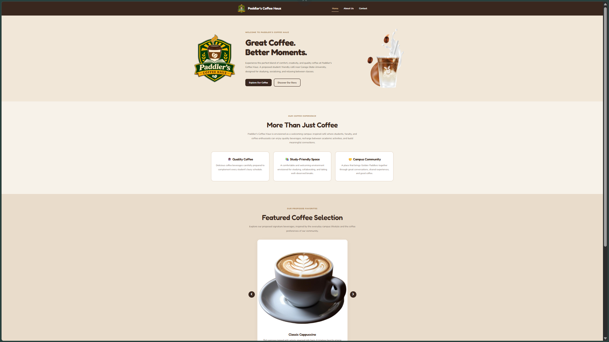
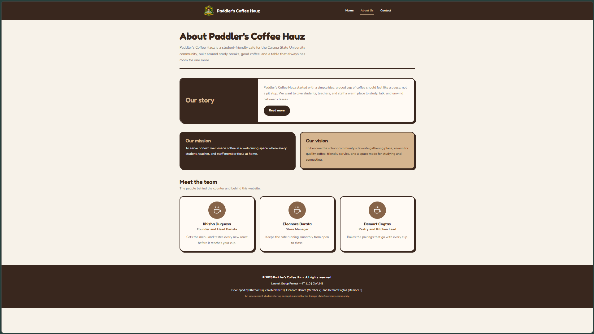
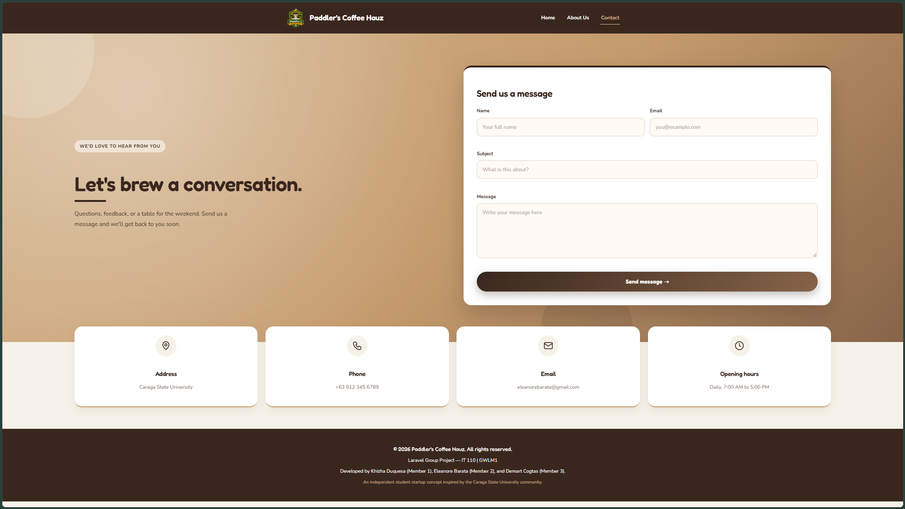

# ☕ Paddler's Coffee Hauz

### IT 110 — GWLM1 | Multi-Page Laravel Web Application

Paddler's Coffee Hauz is a proposed student-friendly café inspired by the Caraga State University community.

This project demonstrates collaborative web development using Laravel, Blade templates, HTML, CSS, JavaScript, Git, and GitHub.

## Project Information

| Information | Details |
|---|---|
| Project Title | Paddler's Coffee Hauz |
| Course / Section | IT 110 — GWLM1 |
| Application Theme | Café / Coffee Shop |
| Framework | Laravel 13 |
| Frontend | HTML, CSS, JavaScript, Blade |
| Version Control | Git and GitHub |

## Group Members and Assigned Modules

| Member | Name | Responsibility | Branch |
|---|---|---|---|
| 1 — Leader | Khizha Duquesa | Project Setup, Shared Layout, Home Page | `dev-member1-Duquesa` |
| 2 | Eleanore Barata | About Page | `dev-member2-Barata` |
| 3 | Demart Cogtas | Contact Page | `dev-member3-Cogtas` |

## Application Features

### Home Page — Member 1
- Shared navigation and footer
- Café logo and branding
- Hero section and introduction
- Interactive JavaScript coffee carousel
- Responsive café-inspired interface

### About Page — Member 2
- Business background and story
- Mission and vision
- Team member cards
- Interactive Read More functionality

### Contact Page — Member 3
- Contact form
- JavaScript form validation
- Contact information
- Responsive layout

## Application Screenshots

### 1. Home Page

### 2. About Page

### 3. Contact Page

## Installation and Setup

### Prerequisites

- PHP compatible with the project
- Composer
- Node.js and npm
- Git

### Clone the Repository

    git clone https://github.com/kdzyoda/Lara-Proj-GWLM1-Duquesa-Barata-Cogtas.git

    cd Lara-Proj-GWLM1-Duquesa-Barata-Cogtas

### Install Dependencies

    composer install

    npm install

### Configure Laravel

Copy `.env.example` to `.env`.

Windows Command Prompt:

    copy .env.example .env

Generate the application key:

    php artisan key:generate

Configure your database connection in `.env` if needed.

Run migrations:

    php artisan migrate

### Build Frontend Assets

    npm run build

### Run the Application

    php artisan serve

Open:

http://127.0.0.1:8000

## Application Routes

| Page | URL |
|---|---|
| Home | `/` |
| About | `/about` |
| Contact | `/contact` |

## Git Collaboration

Each member developed their assigned module on a dedicated branch and submitted a Pull Request.

The group leader reviewed and merged the contributions into `main`.

An additional Pull Request corrected the integrated routing configuration.

## Project Scope

Paddler's Coffee Hauz is an independent academic startup concept inspired by the Caraga State University community. It is not presented as an officially operating or university-endorsed café.

## GitHub Repository

https://github.com/kdzyoda/Lara-Proj-GWLM1-Duquesa-Barata-Cogtas
